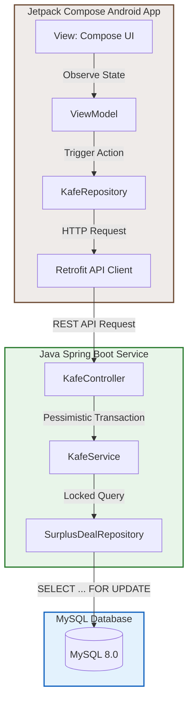

# End-of-Day Kafe ☕

[](https://kotlinlang.org)
[](https://developer.android.com/jetpack/compose)
[](https://openjdk.org)
[](https://spring.io/projects/spring-boot)
[](https://www.mysql.com)
[](https://www.docker.com)

**End-of-Day Kafe** is a mobile-first rescue marketplace designed to connect local cafes and restaurants in Phnom Penh with users wanting to rescue surplus food at the end of the day. Instead of food going to waste, users get high-quality, cheap deals, and businesses recover their ingredient costs.

---

## Architecture Flow



---

## Prevention of Concurrency Race Conditions

When multiple users try to claim the last available mystery bag simultaneously, standard queries could cause a double-sell. This project prevents this race condition by using a database-level row lock.

During a reservation transaction:
1. Spring Boot queries the item using the `PESSIMISTIC_WRITE` lock:
   ```sql
   SELECT quantity_available FROM surplus_deals WHERE id = ? FOR UPDATE;
   ```
2. The database blocks other threads or transactions trying to query or write to that specific row until the current transaction completes.
3. The server decrements the quantity and saves it back, ensuring thread-safe transactional consistency.

---

## Project Structure

```
.
├── docker-compose.yml       # MySQL Database container config
├── backend/                  # Java 21 & Spring Boot 3.2.5 REST API
│   ├── pom.xml
│   └── src/
│       ├── main/java/com/kafe/
│       │   ├── EndOfDayKafeApplication.java
│       │   ├── config/DatabaseSeeder.java      # Auto-mocks Phnom Penh cafes
│       │   ├── controller/KafeController.java
│       │   ├── model/                          # JPA Entities
│       │   ├── repository/                     # Custom Locked Repositories
│       │   └── service/KafeService.java        # Transaction Logic
│       └── test/java/com/kafe/service/         # Concurrency Integration Tests
└── android/                  # Jetpack Compose MVVM Android Application
    ├── build.gradle.kts
    └── app/src/main/java/com/kafe/android/
        ├── MainActivity.kt
        ├── model/Models.kt
        ├── network/KafeApi.kt
        ├── repository/KafeRepository.kt
        ├── viewmodel/KafeViewModel.kt
        └── ui/
            ├── MainScreen.kt
            └── components/DealCard.kt
```

---

## Getting Started

### 1. Database Setup
Start the MySQL database instance:
```bash
# If running for the first time:
docker run -d --name end-of-day-db -p 3307:3306 -e MYSQL_DATABASE=end_of_day_db -e MYSQL_USER=kafe_user -e MYSQL_PASSWORD=kafe_password -e MYSQL_ROOT_PASSWORD=root_password mysql:8.0

# If the container already exists but is stopped:
docker start end-of-day-db

# To stop the container:
docker stop end-of-day-db
```

### 2. Run and Seed the Backend
Go to the `backend/` directory and compile/run the project:
```bash
cd backend
mvn clean spring-boot:run
```
Upon starting, the database seeder will automatically insert 6 Phnom Penh-based cafes (around BKK1 & Tuol Tom Poung coordinates) along with 15 random active deals containing mock images and low stock limits to demonstrate real-time feed activity.

To verify the seed data, hit the endpoint:
```bash
curl http://localhost:8082/api/deals
```

### 3. Launch the Android Client
Open the `android/` directory using **Android Studio**. Build and run the app on an Android Emulator or connected physical device. 

The Android app dynamically determines the target API URL based on the environment at runtime:
* **Release Build (Production):** Connects to the production server URL.
* **Debug Build (Emulator):** Connects to `10.0.2.2:8082` (or `10.0.3.2:8082` for Genymotion) to access the host computer's backend.
* **Debug Build (Physical Phone):** Connects to your laptop's current local network IP (`10.10.10.77:8082`).

#### Network & Firewall Configuration (For Physical Device Testing)
If running on a physical phone:
1. Make sure your phone and laptop are on the **same Wi-Fi network**.
2. Verify that your laptop's local IP matches the address in `KafeApi.kt` (`10.10.10.77`).
3. Allow incoming network traffic to port `8082` through your Linux firewall:
   ```bash
   sudo ufw allow 8082/tcp
   ```
